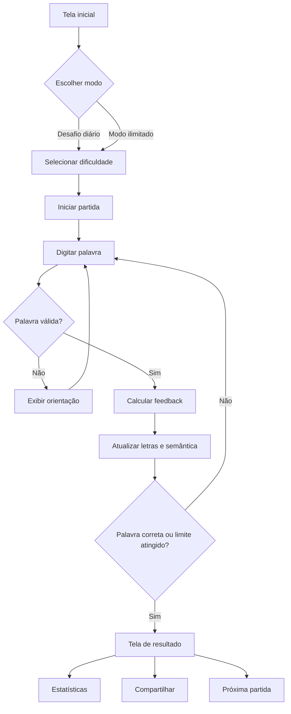

# PRD: Jogo Casual de Adivinhação de Palavras

## 1. Resumo executivo

Criar um jogo casual mobile-first de adivinhação de palavras em português brasileiro, combinando duas mecânicas complementares:

- feedback posicional por letras, inspirado em Termo e Wordle;
- proximidade semântica, inspirada em Contexto, para indicar o quanto cada tentativa se aproxima da palavra secreta.

O produto oferecerá desafios diário e ilimitado, com três níveis de dificuldade, estatísticas, compartilhamento de resultados e placar. O MVP será distribuído inicialmente como aplicação web completa, com arquitetura preparada para publicação posterior em Android e iOS.

## 2. Contexto e pesquisa de mercado

### 2.1 Referências analisadas

**Wordle / Termo**

- Partida curta, com objetivo único e poucas tentativas.
- Feedback visual por posição e presença da letra.
- Desafio diário compartilhado por todos os jogadores.
- Interface limitada a elementos essenciais da partida.
- Resultado compartilhável em formato que não revela a resposta.
- Estatísticas locais, sequências e histórico aumentam retenção.
- Modo difícil permite reutilizar informações já descobertas.

**Contexto**

- Em vez de comparar letras, o jogador recebe uma escala de proximidade semântica.
- O valor exploratório estimula tentativas múltiplas e aprendizado.
- Ranking das tentativas ajuda o jogador a interpretar cada novo palpite.
- Os modos diário e ilimitado permitem sessões curtas ou prolongadas.

**Categorias populares derivadas desses modelos**

- Wordle apresenta estruturas de disponibilidade de palavras que precisam considerar significados, regionalismos, gírias, flexões, acentos, letras repetidas e aceitação por dificuldades.
- Semantle e Contexto podem exigir modelos de semântica em português, exigindo uma base linguística ou corpus treinado adequadamente.

### 2.2 Aprendizados aplicáveis ao produto

1. Sessões curtas e objetivos claros favorecem uso casual diário.
2. Feedback visual e interpretável é mais importante que feedback textual excessivo.
3. Uma palavra por dia gera ritual, comunidade e baixo custo cognitivo de entrada.
4. O modo ilimitado evita que o jogador pare após concluir ou falhar o desafio diário.
5. Estatísticas e compartilhamento funcionam como ciclo de engajamento sem depender de competição em tempo real.
6. Consistência linguística e curadoria das palavras evitam frustração por soluções obscuras ou ambíguas.
7. Recursos de acessibilidade, como contraste, texto alternativo e feedback não baseado somente em cor, são essenciais desde o MVP.
8. Não deve haver cópia direta de identidade visual ou marca de Termo, Wordle ou Contexto.

## 3. Público-alvo

### 3.1 Público principal

Pessoas que gostam de jogos de palavras rápidos e casuais, especialmente usuárias que jogam durante intervalos, deslocamentos ou pausas do dia.

### 3.2 Públicos secundários

- Estudantes interessados em ampliar vocabulário.
- Jogadores que gostam de raciocínio lógico.
- Grupos de amigos que compartilham resultados e competem por placares.
- Pessoas que preferem experiências sem salas, partidas ao vivo ou partidas de longa duração.

## 4. Objetivos de produto

### 4.1 Objetivos do MVP

- Permitir compreender e concluir uma partida em menos de três minutos na primeira sessão.
- Entregar feedback claro e consistente em todas as tentativas.
- Incentivar o retorno diário.
- Possibilitar competição amistosa sem exposição excessiva de dados pessoais.
- Garantir uma experiência responsiva em smartphones e computadores.
- Construir uma base técnica preparada para Android, iOS e sincronização opcional de conta.

### 4.2 Métricas de sucesso

- Taxa de conclusão da primeira partida.
- Jogadores ativos por dia.
- Taxa de retorno após um dia, sete dias e 30 dias.
- Partidas iniciadas por usuário.
- Proporção de desafios diário e ilimitado concluídos.
- Taxa de compartilhamento após vitória ou derrota.
- Uso dos três níveis de dificuldade.
- Abertura diária de anúncios e taxa de reprovação/fechamento dos anúncios.

## 5. Mecânica central

A partida possui uma palavra secreta escolhida pelo sistema a partir do nível de dificuldade da sessão.

### 5.1 Feedback por letras

Para cada palpite, o jogo informa:

- letra e posição corretas;
- letra correta em posição incorreta;
- letra ausente da palavra;
- ocorrência correta em palavras com letras repetidas.

O feedback deve usar cor, forma e rótulo textual para não depender exclusivamente da percepção cromática.

### 5.2 Proximidade semântica

Cada tentativa recebe uma pontuação ou faixa de proximidade em relação à palavra secreta e à posição dessa tentativa em um ranking relativo ao restante das palavras avaliadas.

A interface deve apresentar, preferencialmente:

- posição ordinal da tentativa;
- nível semântico visual;
- indicação próxima/média/distante;
- descrição textual acessível da proximidade;
- diferenciação entre tentativa válida e palavra desconhecida pelo sistema.

### 5.3 Integração das duas mecânicas

No MVP, o jogador poderá usar uma combinação:

1. Enviar uma palavra.
2. Receber proximidade semântica.
3. Receber pista posicional de letras.
4. Atualizar uma hipótese ou comparar tentativas anteriores.
5. Resolver até atingir o limite de tentativas ou localizar a palavra secreta.

Para o MVP, a semântica não deverá substituir completamente o feedback por letras. Ambos devem ser apresentados em camadas, permitindo que o jogador escolha qual informação analisar.

## 6. Modos de jogo

### 6.1 Desafio diário

- Uma palavra secreta por dia.
- Mesma palavra para todos os jogadores do mesmo nível.
- Usuários sem conta podem jogar e guardar progresso localmente.
- Usuários com conta podem sincronizar resultado, sequência e estatísticas.
- Resultado diário compartilhável sem revelar a resposta.

### 6.2 Modo ilimitado

- Permite iniciar novas partidas a qualquer momento.
- Cada partida seleciona uma palavra da categoria e dificuldade escolhidas.
- Não há limite diário.
- Deve evitar repetições próximas para usuários sem conta, quando tecnicamente possível.

### 6.3 Níveis de dificuldade

**Fácil**

- Palavras comuns.
- Menor ambiguidade semântica.
- Mais tentativas disponíveis.
- Dica inicial opcional.

**Médio**

- Vocabulário cotidiano de complexidade moderada.
- Limite padrão de tentativas.
- Palavras com semântica menos direta e letras repetidas ocasionais.

**Difícil**

- Vocabulário menos frequente, mas conhecido pelo público adulto.
- Menor quantidade de tentativas.
- Sem dica automática inicial.
- Palavras exclusas de conteúdo ofensivo, obsceno, ambíguo ou excessivamente regionalizado.

## 7. Funcionalidades do MVP

### 7.1 Essenciais

- Configuração de dificuldade.
- Início de partida diária.
- Início de partida ilimitada.
- Teclado na tela.
- Entrada por teclado físico e virtual.
- Validação da palavra enviada.
- Feedback por posição das letras.
- Feedback de proximidade semântica.
- Limite de tentativas.
- Tela de vitória.
- Tela de derrota com revelação da palavra.
- Reinício da partida ilimitada.
- Tratamento de acentos e caracteres especiais em português.
- Tratamento de letras repetidas.
- Persistência local da partida em andamento.
- Timer diário compatível com timezone e mudança de dispositivo.
- Instruções rápidas acessíveis antes da primeira partida.

### 7.2 Conta opcional

- Jogar sem criar conta.
- Criar conta por método definido em fase técnica.
- Entrar e sair.
- Sincronizar estatísticas e progresso quando autorizado.
- Recuperar conta.
- Excluir conta e dados associados.
- Continuar usando dados locais após falha de conexão.

### 7.3 Estatísticas

- Jogos disputados.
- Jogos vencidos.
- Percentual de vitória.
- Sequência atual.
- Melhor sequência.
- Distribuição de tentativas utilizadas.
- Histórico diário.
- Estatísticas separadas por dificuldade.

### 7.4 Compartilhamento

Gerar texto copiável contendo:

- nome do jogo;
- número ou data do desafio;
- dificuldade;
- número de tentativas;
- representação visual do resultado;
- sem a palavra secreta.

O compartilhamento deve funcionar por API nativa, copiar para área de transferência e compartilhar em redes sociais.

### 7.5 Ranking

- Ranking do desafio diário por dificuldade.
- Métrica principal: menor quantidade de tentativas.
- Critério de desempate: menor tempo de conclusão.
- Apresentar posição do jogador, usuário ou apelido público e pontuação.
- Definir período diário e, opcionalmente, semanal e geral.
- Permitir optar por participar com perfil pseudônimo.

### 7.6 Monetização

- Modelo gratuito com anúncios não intrusivos.
- Anúncios não devem aparecer durante uma rodada ativa.
- Momentos permitidos: pós-vídeo de resultado, tela inicial entre sessões ou intervalos explícitos.
- Respeitar consentimento de privacidade e legislação aplicável.
- Deve existir configuração para limitar publicidade personalizada quando disponível.
- Não bloquear jogabilidade, progresso ou recursos essenciais por anúncios.

### 7.7 Configurações e acessibilidade

- Tema claro e escuro.
- Tema de alto contraste.
- Feedback por símbolo além de cor.
- Tamanho mínimo de área tocável.
- Redução de movimento.
- Compatibilidade com leitores de tela.
- Legendas ou descrições textuais para sinais gráficos.
- Preferências persistidas localmente.
- Recurso para reiniciar o jogo preservando dados da conta.

## 8. Experiência do usuário

### 8.1 Fluxo principal

### 8.2 Estados de interface

- primeira visita;
- instruções rápidas;
- partida em andamento;
- tentativa inválida;
- palavra desconhecida;
- sem conexão;
- partida concluída;
- palavra já utilizada;
- erro de servidor;
- sessão restaurada;
- conta não autenticada;
- ranking indisponível.

### 8.2 Requisitos de UX

- O usuário deve compreender a primeira tentativa em até 30 segundos.
- Erros devem ser resolvidos sem perder tentativas válidas.
- O feedback semântico deve ser legível sem abrir ajuda adicional.
- A navegação deve exigir no máximo dois toques para iniciar uma partida diária.
- A partida deve sobreviver a atualização ou interrupção não destrutiva.
- Modais não podem bloquear permanentemente conteúdo ou ação principal.

## 9. Requisitos funcionais

| ID | Requisito |
|---|---|
| RF01 | O sistema deve iniciar partidas diária ou ilimitada. |
| RF02 | O sistema deve permitir fácil, médio e difícil. |
| RF03 | O sistema deve validar extensão, caracteres e existência da palavra. |
| RF04 | O sistema deve indicar letras corretas, presentes e ausentes. |
| RF05 | O sistema deve calcular o feedback de proximidade semântica. |
| RF06 | O sistema deve tratar letras repetidas corretamente. |
| RF07 | O sistema deve finalizar a partida após acerto ou esgotamento das tentativas. |
| RF08 | O sistema deve salvar o progresso local da partida. |
| RF09 | O sistema deve permitir criar, acessar e excluir uma conta opcional. |
| RF10 | O sistema deve sincronizar progresso autenticado quando disponível. |
| RF11 | O sistema deve calcular estatísticas por modo e dificuldade. |
| RF12 | O sistema deve gerar resultado compartilhável sem revelar a resposta. |
| RF13 | O sistema deve manter ranking diário por dificuldade. |
| RF14 | O sistema deve apresentar anúncios fora das rodadas ativos. |
| RF15 | O sistema deve permitir tema claro, escuro e alto contraste. |
| RF16 | O sistema deve anunciar estados e feedback para tecnologias assistivas. |
| RF17 | O sistema deve restaurar partidas interrompidas. |

## 10. Requisitos não funcionais

- Compatibilidade com navegadores móveis modernos e desktop.
- Interface responsiva para celulares, tablets e desktop.
- Arquitetura preparada para empacotamento como PWA ou aplicativo híbrido em Android/iOS.
- Tempo de resposta visível do feedback inferior a 500 ms quando o modelo semântico estiver disponível localmente.
- Sincronização de conta tolerante a falha de rede.
- Persistência sem perda de progresso em atualização ou mudança temporária de conexão.
- Proteção contra manipulação simples de placar.
- Consentimento e preferências de privacidade registrados.
- Observabilidade mínima para taxa de erros, disponibilidade e retenção.
- Tratamento seguro de dados de conta e identificadores.

## 11. Conteúdo linguístico

### 11.1 Requisitos do dicionário

- Português brasileiro como idioma de lançamento.
- Acentuação normalizada para entrada e comparação.
- Aceitar palavras válidas independentes da capitalização.
- Separar palavras aceitas como tentativa de palavras elegíveis como solução.
- Evitar soluções ofensivas, obscenas, ambíguas ou excessivamente específicas.
- Armazenar palavras em conjuntos curados por dificuldade.
- Permitir edição editorial sem alterar partidas já concluídas.

### 11.2 Semântica

O MVP deve usar um modelo ou dados compatíveis com português brasileiro. Os critérios mínimos são:

- proximidade estável para sinônimos, hiperônimos, hipônimos e relações contextualizadas;
- reduzir proximidade artificial entre palavras simplesmente semelhantes em letras;
- indicar explicitamente palavras fora do vocabulário conhecido;
- disponibilizar regras para atualizar o modelo sem alterar o resultado de partidas históricas;
- permitir auditoria editorial de palavras que recebem pontuação absurda ou inconsistente.

## 12. Monetização e privacidade

### 12.1 Anúncios

- Colocar anúncios fora do fluxo de jogo ativo.
- Respeitar limites e frequência definidos pela plataforma.
- Não exibir anúncio que cubra resultado, botões ou feedback essencial.
- Não vender dados de jogo diretamente.
- Fazer limpeza de rastreamento conforme consentimento.

### 12.2 Dados

Dados mínimos recomendados:

- identificador de conta;
- apelido ou nome público opcional;
- estatísticas de partida;
- preferência de tema e dificuldade;
- registro de consentimento;
- identificadores técnicos necessários à estabilidade e segurança.

Dados não necessários ao MVP:

- dados sensíveis;
- contatos pessoais;
- localização precisa;
- acesso a arquivos ou mídia fora da funcionalidade necessária.

## 13. Fora do escopo

- Partidas multiplayer síncronas.
- Chat em tempo real.
- Criador de desafios comunitário na primeira versão.
- Modo de torneio.
- Vídeos ou transmissões dentro do jogo.
- Monetização por assinatura.
- Consolidação editorial completa de variantes regionais portuguesas no MVP.
- Aplicativos nativos publicados antes da validação da versão web.

## 14. Riscos e mitigação

| Risco | Impacto | Mitigação |
|---|---|---|
| Modelo semântico ruim em português | Frustração e baixa credibilidade | Curadoria editorial, corpus específico, testes de proximidade e fallback explicativo |
| Palavras ambíguas ou obscuras | Abandono da partida | Listas curadas por dificuldade e revisão de soluções |
| Publicidade excessiva | Retenção deteriorada | Limites de frequência, ausência de anúncio durante partidas |
| Jogador competir com múltiplos contas | Ranking adulterado | Limites, proteção de endpoint, conta opcional com pseudônimo |
| MVP mobile/web discordante | Aumento de prazo | Priorizar aplicação web responsiva/PWA e definir uma única experiência de navegação |
| Correlação de cores | Dificuldade para jogadores daltônicos | Símbolos, padrões, textos e tema de alto contraste |
| Acentuação e normalização | Palavras válidas rejeitadas | Testes específicos para português brasileiro e normalização Unicode |

## 15. Plataformas e entrega

A decisão de produto é iniciar com uma aplicação web responsiva e completa, porque essa entrega permite validar o mesmo núcleo em Android e iOS por navegador antes da publicação nativa.

A publicação nativa não faz parte da entrega mínima e deve ocorrer após validação do MVP, com:

- empacotamento como PWA ou aplicação híbrida;
- publicação nas lojas Android e iOS;
- autenticação opcional;
- notificações de desafio diário, se aprovadas pelo jogador;
- sincronização entre plataformas.

## 16. Critérios de aceitação

- Um jogador consegue iniciar o modo diário ou ilimitado sem ajuda externa.
- Uma jogada inválida não remove a tentativa válida anterior.
- O feedback de letras é correto para letras repetidas e acentos normalizados.
- O feedback semântico é mostrado junto com uma explicação compreensível.
- Uma partida pode ser restaurada após recarregar a página.
- Conta opcional não impede acesso ao jogo.
- Um jogador pode compartilhar o resultado sem mostrar a palavra secreta.
- Estatísticas refletem o resultado de partidas concluídas uma única vez.
- Ranking diário separa dificuldade e trata empates de forma documentada.
- Anúncios não aparecem dentro da partida ativa.
- Tema de alto contraste e leitores de tela conseguem interpretar o estado da partida.

## 17. Próximos passos

1. Validar a viabilidade técnica da proximidade semântica em português brasileiro.
2. Elaborar protótipo navegável das telas inicial, partida, resultado e ranking.
3. Definir nome, identidade visual e política editorial do vocabulário.
4. Definir arquitetura de conta opcional, persistência local e sincronização.
5. Criar modelo inicial de ranking seguro.
6. Definir fornecedores e política de anúncios.
7. Executar testes com usuários casuais para validar curva de dificuldade.
8. Planejar a versão mobile/PWA após aprovação do MVP web.

## 18. Fontes da pesquisa

- Wikipédia, Wordle: https://en.wikipedia.org/wiki/Wordle
- The New York Times, Wordle: https://www.nytimes.com/games/wordle/index.html
- Contexto, modo diário e ilimitado: https://contexto.me/
- Contexto Brasil: https://contexto.me/pt/
- Wikipedia, jogos de caça-palavras: https://en.wikipedia.org/wiki/Word_search
- Wikipedia, Mastermind, referência histórica citada pelo Wordle: https://en.wikipedia.org/wiki/Mastermind_(board_game)
