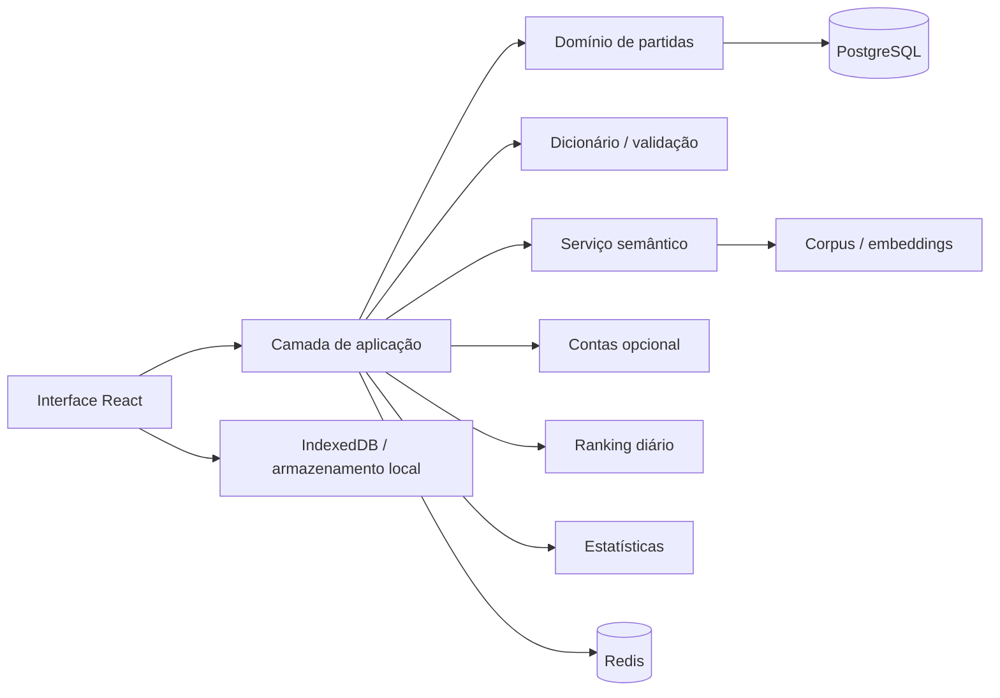
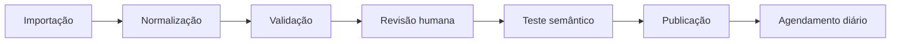

# SPECS — Especificação Técnica do Jogo de Adivinhação de Palavras

## 1. Finalidade

Este documento define como implementar o jogo descrito em [PRD.md](PRD.md), usando como referência visual o Protótipo 03, "Painel de pista", disponível em [prototype-3.html](prototype-3.html).

O produto será uma aplicação web responsiva, mobile-first e instalável como PWA, em português brasileiro, com:

- desafio diário;
- modo ilimitado;
- níveis fácil, médio e difícil;
- feedback posicional de letras;
- proximidade semântica;
- ranking diário;
- conta opcional;
- compartilhamento;
- anúncios fora das partidas;
- acessibilidade completa em teclado e tecnologias assistivas.

## 2. Referência de design escolhida

### 2.1 Identidade visual

O Protótipo 03 usa uma linguagem utilitária, organizada e orientada a dados. A interface não deve parecer uma cópia de Wordle, Termo ou Contexto.

Tokens principais observados:

- fundo neutro claro: `#e9ece8`;
- fundo principal claro: `#fafaf7`;
- superfície escura: `#17211b`;
- destaque coral: `#df7957`;
- destaque ciano semântico: `#b8d9dd`;
- destaque amarelo posicional: `#dfc45b`;
- destaque verde/lima: `#b7cf56`;
- bordas neutras: `#ccd1cd`.

Tipografia de interface:

- títulos e valores: fonte serifada expressiva local ou baseada em fallback;
- corpo e controles: fonte sem serifa legível;
- metadados: fonte monoespaçada;
- nenhuma fonte deverá depender exclusivamente de serviço externo de terceiros.

### 2.2 Estrutura desktop

1. Cabeçalho fixo com marca, ação de ranking e configurações.
2. Barra lateral fixa com nível de dificuldade e modo.
3. Área central com título da rodada, tentativa atual e posição no ranking.
4. Grade principal dividida em painel de palavras e painel semântico.
5. Painel de palavras ocupando cerca de 60% da largura.
6. Painel semântico ocupando cerca de 40% da largura.
7. Rodapé de ajuda ou atalhos, quando necessário.

### 2.3 Estrutura mobile

1. Cabeçalho compacto com marca, dificuldade e configurações.
2. Seletores de modo e nível como controles horizontais.
3. Painel de palavras acima do painel semântico.
4. Lista de tentativas organizada verticalmente.
5. Ação principal fixa na parte inferior, sem cobrir conteúdo essencial.
6. Barra lateral transformada em drawer acessível.
7. Conteúdo com largura mínima suficiente para evitar rolagem horizontal.

### 2.4 Breakpoints

- `<= 359px`: layout de uma coluna com tipografia reduzida;
- `360px–699px`: layout mobile completo;
- `700px–1023px`: layout mobile expandido ou tablet;
- `>= 1024px`: painel lateral e grade em duas colunas;
- `>= 1440px`: largura máxima de conteúdo de 960px centralizada.

## 3. Stack tecnológica

### 3.1 Web

- Framework: Next.js com App Router e TypeScript.
- Renderização: páginas públicas e telas públicas em SSR ou SSG; partidas em componentes client-side quando necessário.
- Estilo: CSS Modules ou Tailwind, preferencialmente seguindo tokens CSS centralizados.
- Estado cliente: Zustand para estado de sessão e preferências, React Query para dados remotos.
- Validação de formulários: Zod compartilhado entre cliente, servidor e contratos de API.
- Ícones: biblioteca instalada localmente, sem SVGs manuais fora de componentes de marca e ilustrações próprias.
- Testes de interface: Vitest, React Testing Library e Playwright.

### 3.2 Backend

- Runtime: Node.js com TypeScript.
- API: Route Handlers ou Server Actions do Next.js para o MVP.
- Persistência: PostgreSQL.
- Cache e filas: Redis quando houver necessidade de ranking competitivo ou cálculo semântico assíncrono.
- Semântica: serviço próprio com embeddings e corpus curado em português brasileiro.
- Autenticação: provider OpenID Connect ou biblioteca de autenticação compatível com conta opcional.
- Storage de arquivo não é necessário no MVP.

### 3.3 Infraestrutura

- Hospedagem web: plataforma com suporte a Node.js e PostgreSQL gerenciado.
- CDN para assets estáticos.
- Logs estruturados com correlation ID.
- Monitoramento de disponibilidade, taxa de erro e latência de API.
- Backups automáticos e restauráveis do PostgreSQL.
- Migrações aplicadas por ferramenta de schema.
- Banco separado para desenvolvimento, homologação e produção.

### 3.4 PWA

- Manifesto com nome, ícones, tema, fundo, orientação e start URL.
- Service worker com cache de shell, assets e conteúdo público.
- Navegação offline para partida já iniciada e dados locais persistidos.
- Estado remoto indisponível deve ser sinalizado sem impedir jogo local.

## 4. Arquitetura



### 4.1 Fronteiras

O domínio não deve depender diretamente de React, Next.js, banco ou serviço externo. Recomenda-se separar:

- `domain`: entidades, regras, máquinas de estado e funções puras;
- `application`: casos de uso e orquestração;
- `infra`: banco, autenticação, cache, embeddings e anúncios;
- `presentation`: componentes, hooks e rotas.

A seguinte estrutura inicial é recomendada:

```text
app/
  (game)/
  api/
components/
  game/
    AttemptHistory.tsx
    LetterGrid.tsx
    SemanticPanel.tsx
    DifficultyMenu.tsx
    ModeMenu.tsx
    ResultDialog.tsx
  layout/
  ui/
lib/
domain/
  game/
    Game.ts
    evaluateGuess.ts
    validateGuess.ts
    normalizeWord.ts
  language/
    dictionary.ts
    semanticScore.ts
application/
infra/
scripts/
public/
tests/
```

## 5. Modelo de domínio

### 5.1 Entidades

#### Partida

```typescript
interface Game {
  id: string;
  mode: "daily" | "unlimited";
  difficulty: "easy" | "medium" | "hard";
  puzzleId: string;
  answer: string;
  attempts: Guess[];
  attemptLimit: number;
  status: "in_progress" | "won" | "lost";
  startedAt: string;
  completedAt?: string;
}
```

#### Tentativa

```typescript
interface Guess {
  word: string;
  submittedAt: string;
  letterFeedback: LetterFeedback[];
  semantic: {
    score: number;
    rank: number;
    percentile: number;
    label: "distante" | "proxima" | "muito_proxima";
  };
}

interface LetterFeedback {
  letter: string;
  normalizedLetter: string;
  state: "correct" | "present" | "absent";
}
```

#### Jogador

```typescript
interface Player {
  id: string;
  displayName?: string;
  anonymousId: string;
  joinedAt: string;
}
```

### 5.2 Máquina de estados

```text
IDLE
  -> STARTING
  -> IN_PROGRESS
IN_PROGRESS
  -> VALIDATING_GUESS
VALIDATING_GUESS
  -> INVALID_GUESS -> IN_PROGRESS
  -> GUESS_ACCEPTED
GUESS_ACCEPTED
  -> WON
  -> LOST
  -> IN_PROGRESS
IN_PROGRESS
  -> RESTORED
WON / LOST
  -> RESULT
RESULT
  -> DAILY
  -> UNLIMITED
```

### 5.3 Limites de tentativa

- fácil: 8 tentativas;
- médio: 6 tentativas;
- difícil: 5 tentativas;
- o valor deve vir da configuração editorial e não ser codificado separadamente pela interface.

## 6. Regras da partida

### 6.1 Normalização de palavras

Para entrada, comparação e ranking, aplicar nesta ordem:

1. remover espaços externos;
2. converter para minúsculas;
3. aplicar Unicode NFC;
4. remover hífens ou espaços inválidos;
5. preservar acentos para o armazenamento editorial;
6. criar chave de comparação sem diacríticos;
7. comparar extensão por número de letras normalizado.

A palavra deve ser aceita visualmente com acentos, mas pode ter a mesma chave de comparação sem acento. Exemplos como `avó` e `avo` não devem ser tratados como entradas válidas equivalentes.

### 6.2 Feedback de letras repetidas

O cálculo deve seguir o padrão de atribuição em duas fases:

1. marcar todas as posições exatas como `correct`;
2. para letras restantes da resposta, marcar ocorrências não usadas como `present`;
3. demais ocorrências serão `absent`;
4. feedback não pode contar mais ocorrências do que existem na resposta.

A implementação não pode usar `indexOf` isoladamente e deve ser coberta por testes unitários para palavras com repetições.

### 6.3 Validação da tentativa

A tentativa é rejeitada quando:

- estiver vazia;
- tiver comprimento incorreto;
- contiver caracteres inválidos;
- não estiver aprovada pelo dicionário de validação;
- já foi enviada na mesma partida;
- o estado da partida não estiver em andamento;
- exceder o limite configurado.

Erros devem retornar código e mensagem destinados à UI:

```typescript
type GuessErrorCode =
  | "EMPTY"
  | "INVALID_LENGTH"
  | "INVALID_CHARACTERS"
  | "UNKNOWN_WORD"
  | "DUPLICATE"
  | "GAME_FINISHED";
```

### 6.4 Desafio diário

- A chave diária combina data, timezone editorial e dificuldade.
- Todos os usuários da mesma dificuldade recebem a mesma palavra.
- A borda de data deve seguir timezone do serviço, não timezone adiantada ou atrasada do dispositivo.
- Uma vez concluída, a partida diária não pode ser reiniciada pela mesma chave no dispositivo.
- Uma mudança de timezone no dispositivo não pode causar outro desafio do dia sem confirmação do servidor.

### 6.5 Modo ilimitado

- Cada partida recebe um puzzle randomizado elegível para dificuldade.
- Evitar repetir uma solução nas últimas partidas locais.
- Evitar sobreposição excessiva de resposta, de acordo com a configuração editorial.
- Permitir iniciar uma nova partida enquanto o resultado anterior permanece disponível.

## 7. Proximidade semântica

### 7.1 Modelo

O MVP deve usar embeddings em português brasileiro treinados ou pré-treinados por meio de corpus autorizado. O modelo não deve confiar em similaridade ortográfica.

O score de uma tentativa será calculado por similaridade de cosseno normalizada:

```text
score = round(100 * (1 + cosine(embedding(tentativa), embedding(resposta))) / 2)
```

Se a infraestrutura não estiver disponível:

- tentar lista de proximidade pré-computada do puzzle;
- se o cache também falhar, informar que a camada semântica está indisponível;
- executar apenas feedback posicional e não inventar um score aleatório.

### 7.2 Rank

O rank semântico não deve ser comparado diretamente entre puzzles diferentes quando o conjunto de palavras de cada dificuldade variar.

Para cada puzzle, pré-calcular:

- rank da tentativa entre todas as palavras elegíveis;
- percentil;
- faixa de proximidade;
- score bruto não exposto ao cliente.

Faixas sugeridas:

- 0–19: distante;
- 20–59: próxima;
- 60–100: muito próxima;

Os limites finais devem ser definidos por validação editorial de dados reais.

### 7.3 Segurança do cálculo

- O embedding da resposta não deve ser enviado ao cliente.
- O cliente pode receber score, rank, percentil e faixa, mas não vetor, resposta ou ranking completo do modelo.
- Palavras desconhecidas devem receber estado específico `UNKNOWN_SEMANTICS`.
- O score não deve ser atualizado durante uma mudança de conteúdo editorial já publicada.

## 8. API

### 8.1 Contratos iniciais

```text
POST   /api/games/start
POST   /api/games/:gameId/guesses
GET    /api/games/:gameId
POST   /api/games/:gameId/finish
GET    /api/puzzles/daily?difficulty=medium
GET    /api/ranking/daily/:puzzleId
GET    /api/player/stats
GET    /api/player/preferences
PATCH  /api/player/preferences
POST   /api/auth/optional-account
DELETE /api/player/account
POST   /api/analytics/share
```

### 8.2 Iniciar partida

```json
{
  "mode": "daily",
  "difficulty": "medium"
}
```

Resposta mínima:

```json
{
  "gameId": "uuid",
  "mode": "daily",
  "difficulty": "medium",
  "attemptLimit": 6,
  "attemptCount": 0,
  "status": "in_progress",
  "dailyNumber": 301
}
```

### 8.3 Enviar tentativa

```json
{
  "word": "monte"
}
```

Resposta mínima:

```json
{
  "attemptNumber": 3,
  "letterFeedback": [],
  "semantic": {
    "score": 82,
    "rank": 12,
    "percentile": 99,
    "label": "muito_proxima"
  },
  "gameStatus": "in_progress"
}
```

### 8.4 Erros

Todas as respostas de erro seguirão:

```json
{
  "error": {
    "code": "UNKNOWN_WORD",
    "message": "Essa palavra não está no dicionário de jogo."
  }
}
```

Códigos HTTP:

- `400`: entrada inválida;
- `401`: autenticação necessária para endpoint específico;
- `403`: estado de jogo ou ação não autorizada;
- `404`: partida ou recurso inexistente;
- `409`: estado concorrente ou tentativa duplicada;
- `429`: limite de requisições;
- `500`: erro interno sem detalhes sensíveis;
- `503`: serviço semântico temporariamente indisponível.

## 9. Persistência

### 9.1 Armazenamento local

Usar IndexedDB com um único repository de jogo. O objeto persistido deve conter:

- versão do schema;
- chave da partida;
- estado da partida;
- tentativas;
- preferências necessárias à interface;
- timestamp da última alteração.

Uma migração cliente deve evoluir a partir da versão anterior sem perda de progresso.

### 9.2 IndexedDB

Objetos principais:

```text
local_games
local_stats
preferences
sync_queue
consents
```

### 9.3 Sincronização

- Sempre gravar localmente antes da sincronização.
- Adicionar alteração à fila quando offline.
- Sincronizar automaticamente ao voltar online.
- Resolver conflitos por horário da última alteração, com confirmação em caso ambíguo.
- A partida diária concluída é idempotente por chave de usuário e puzzle.
- Dados locais anônimos podem ser vinculados à conta opcional após confirmação do usuário.

### 9.4 Tabelas PostgreSQL

```text
players
anonymous_profiles
daily_puzzles
unlimited_puzzles
word_entries
word_embeddings
game_sessions
guess_attempts
player_statistics
ranking_entries
consents
share_events
```

Restrições essenciais:

- unicidade diária por puzzle, data e dificuldade;
- unicidade da participação do jogador no ranking por puzzle;
- índice por status e data de partida;
- índices por usuário e data das tentativas;
- exclusão ou anonimização compatível com conta excluída;
- soft delete para conteúdo editorial publicado.

## 10. Interfaces principais

### 10.1 Partida

Desktop:

- barra lateral esquerda fixa;
- painel de palavras à esquerda;
- painel semântico à direita;
- cabeçalho com tentativa atual e ranking;
- ação principal de enviar palavra logo abaixo das tentativas.

Mobile:

- conteúdo em uma coluna;
- histórico de tentativas acima da entrada atual;
- painel semântico abaixo ou em acordeão;
- ação principal visível sem cobrir as linhas;
- drawer lateral acionável por botão de configurações.

### 10.2 Resultado

A tela de resultado deve incluir:

- palavra secreta;
- tentativas utilizadas;
- tempo de conclusão;
- número de posição ou ranking, se disponível;
- estatísticas resumidas;
- ação de compartilhar;
- iniciar modo ilimitado;
- voltar ao início;
- anúncio após resultado, respeitando frequência e consentimento.

### 10.3 Ranking

Campos por linha:

- posição;
- apelido ou jogador anônimo associado;
- tentativas;
- tempo;
- indicador se o resultado é próprio;
- dificuldade e data.

Critério de ordenação:

1. menor número de tentativas;
2. menor tempo de conclusão;
3. menor timestamp de término;
4. empate permanente registrado pelo servidor.

### 10.4 Configurações

- modo de alto contraste;
- tema claro ou escuro;
- redução de movimento;
- tamanho de texto;
- feedback sonoro opcional;
- perfil público e ranking;
- privacidade e anúncios;
- sair da conta;
- excluir dados.

## 11. Conteúdo linguístico

### 11.1 Dicionário

Manter dois conjuntos:

```text
accepted_words: palavras válidas como tentativa;
solution_words: palavras elegíveis como resposta;
```

Cada entrada deve conter:

- forma, variante ou flexão;
- chave sem acentos;
- dificuldade mínima;
- status editorial;
- frequência estimada;
- embedding;
- timestamp de revisão.

### 11.2 Curadoria

- soluções ofensivas ou obscenas são proibidas;
- palavras excessivamente regionais devem ser marcadas;
- siglas, nomes próprios, estrangeirismos e abreviações não são solução sem aprovação editorial;
- palavras com múltiplos significados ambíguos precisam de justificativa editorial;
- alterações editoriais não podem mudar partidas concluídas.

### 11.3 Pipeline editorial



## 12. Acessibilidade web

### 12.1 WCAG

Implementar o nível AA do WCAG 2.2:

- contraste de texto mínimo 4.5:1;
- contraste de componentes e estados mínimo 3:1;
- áreas de toque mínimas de 44 por 44 CSS pixels;
- ordem de foco lógica;
- foco visível;
- sem dependência exclusiva de cor;
- conteúdo não deve ser ativado apenas por hover;
- zoom de 200% sem perda funcional;
- preferência de movimento reduzido.

### 12.2 Feedback não cromático

- correto: símbolo `✓`, label "correta", padrão preenchido;
- presente em outra posição: símbolo `↔`, label "presente em outra posição";
- ausente: símbolo `−`, label "ausente";
- semântica: texto com faixa, percentil ou rank.

### 12.3 Leitor de tela

- cada tentativa deve receber descrição textual completa;
- atualizações semânticas devem usar live region concisa;
- não anunciar automaticamente a grade inteira a cada tentativa;
- resultado e erros devem receber foco ou live region apropriadamente;
- páginas devem ter landmarks, headings e labels únicos;
- modal deve preservar foco e impedir navegação indevida ao fundo.

### 12.4 Teclado

Atalhos mínimos:

- letras do teclado físico: preencher tentativa;
- Enter: enviar tentativa;
- Backspace: apagar letra;
- Escape: fechar modal;
- Tab / Shift+Tab: navegar;
- não usar atalhos que exigem combinações de teclas não documentadas.

## 13. Segurança

### 13.1 Autenticação e contas

- tokens armazenados por mecanismo seguro e protegido contra XSS;
- cookie HttpOnly para sessão quando aplicável;
- CSRF para operações autenticadas;
- MFA opcional em fase posterior;
- confirmação para exclusão de conta;
- revogação de sessões.

### 13.2 Ranking

- servidor revalida todas as tentativas e timestamps;
- impedir envio de resultados diretamente sem partida registrada;
- rate limiting por endereço, conta e dispositivo;
- assinaturas ou tokens anti-replay para conclusões críticas;
- alertas de padrões anômalos de resultado.

### 13.3 Privacidade

- coleta de analytics no mínimo necessário;
- consentimento registrado antes de publicidade personalizada;
- apelido pseudônimo por padrão;
- política de retenção definida por tipo de dado;
- exclusão de conta remove vínculo de estatísticas pessoais;
- logs não podem conter palavras de solução, tokens ou dados sensíveis.

## 14. Anúncios

- anúncios não podem aparecer em partida ativa;
- momentos permitidos:
  - resultado concluído;
  - tela inicial após intervalo definido;
  - modo ilimitado entre partidas.
- frequência deve ser configurável e limitada por sessão;
- anúncios nunca bloqueiam ação essencial por tempo excessivo;
- formato deve manter close button acessível por teclado;
- consentimento e restrições de idade devem ser validados;
- ambiente offline nunca tenta redirecionar ou bloquear o usuário por anúncio.

## 15. Observabilidade

Eventos mínimos:

```text
session_started
game_started
guess_submitted
guess_rejected
game_completed
result_shared
ranking_viewed
account_created
account_deleted
ad_requested
ad_displayed
ad_closed
semantic_fallback_used
sync_failed
offline_session_restored
```

Cada evento deve incluir versão da aplicação, modo, dificuldade e correlation ID. Dados pessoais não devem ser incluídos em logs ou eventos analytics.

Métricas técnicas:

- tempo P50, P95 e P99 da API;
- taxa de erro por endpoint;
- disponibilidade semântica;
- taxa de fallback semântico;
- falhas de sincronização;
- taxa de crash web e service worker;
- taxa de erro de persistência IndexedDB;

## 16. Testes

### 16.1 Testes unitários

Cobrir:

- Unicode NFC;
- remoção de acentos para chave;
- letras repetidas;
- diferenças de feedback presente/ausente;
- limites por dificuldade;
- máquina de estados;
- cosseno semântico e normalização;
- cálculo de rank;
- ordenação de ranking;
- normalização de erros.

Casos mínimos para repetição:

```text
answer = RATO, guess = TORO
answer = CASA, guess = SASS
answer = AVÓ, guess = AVAO
```

### 16.2 Testes de integração

- iniciar e restaurar partida;
- enviar tentativa válida e inválida;
- vencer e perder partida;
- sincronizar dados offline;
- vincular partida local a conta;
- concluir desafio diário duas vezes sem duplicação;
- obter ranking por dificuldade;
- falha de serviço semântico com fallback;
- exclusão de conta.

### 16.3 Testes E2E

Fluxos de Playwright:

1. primeira visita, instruções e início da partida;
2. envio de tentativa por teclado virtual;
3. envio por teclado físico;
4. tentativa inválida sem perda de estado;
5. vitória, resultado e compartilhamento;
6. derrota e revelação da solução;
7. modo ilimitado;
8. mudança de dificuldade;
9. renovação da página e restauração;
10. modo offline;
11. abertura de ranking;
12. navegação do modal por teclado.

### 16.4 Acessibilidade

Rodar automatização com axe e testes manuais:

- navegação por teclado;
- zoom de 200%;
- leitor de tela NVDA;
- leitor de tela VoiceOver;
- contraste de texto;
- tema de alto contraste;
- preferência de movimento reduzido;
- áreas de toque e orientação landscape.

### 16.5 Testes de carga

Validar:

- pico no início do desafio diário;
- leitura de ranking com milhares de registros;
- concorrência na conclusão da partida;
- falha e recuperação da conexão;
- limite de requisições;
- cálculo semântico em lote para publicação de puzzle.

## 17. SEO e compartilhamento

- Metadados básicos em português brasileiro;
- Open Graph e Twitter Card para páginas públicas;
- URL de resultado compartilhável não deve expor solução;
- evitar indexação de páginas autenticadas ou estatísticas privadas;
- página inicial deve oferecer descrição simples, não bloquear a partida em modal;
- mecanismo de compartilhamento deve usar Web Share API e fallback de clipboard;
- texto não deve incluir a palavra secreta.

## 18. Feature flags

Recomendados para o MVP:

```text
semantic_engine
online_ranking
daily_notifications
optional_accounts
advertising
high_contrast_theme
unlimited_mode
in_game_help
```

Todas devem ter estado explícito por ambiente. Anúncios e conta opcional não podem ativar falhas críticas de partida.

## 19. Plano de implementação

### Fase 1: Núcleo

- setup do projeto;
- componentes do Protótipo 03;
- domínio de partida;
- normalização e feedback de letras;
- modo diário e ilimitado;
- persistência local.

### Fase 2: Semântica

- dicionário;
- embeddings ou base pré-calculada;
- score, rank e percentil;
- fallback;
- auditoria editorial.

### Fase 3: Conta e ranking

- conta opcional;
- sincronização;
- estatísticas;
- ranking diário;
- proteção contra fraude.

### Fase 4: Polimento

- acessibilidade;
- PWA;
- compartilhamento;
- temas;
- anúncios e consentimento;
- observabilidade.

### Fase 5: Pré-lançamento

- testes em dispositivos reais;
- homologação;
- carregamento de conteúdo;
- teste de carga;
- revisão editorial;
- execução de QA e lançamento progressivo.

## 20. Critérios de prontidão

A implementação será considerada pronta quando:

- o Protótipo 03 estiver reproduzido responsivamente;
- nenhuma ação essencial depender exclusivamente de cor;
- partidas forem restauradas após atualização da página;
- o usuário puder jogar sem conta;
- a conta, quando criada, sincronizar sem perda de progresso;
- letras repetidas forem avaliadas corretamente;
- semântica em português passar nos casos editoriais definidos;
- ranking não aceitar resultado não associado a partida válida;
- anúncios não aparecerem durante partidas;
- testes unitários, integração, E2E e acessibilidade passarem;
- PWA funcionar em conexão instável;
- backup, rollback de migração e monitoramento estiverem configurados.

## 21. Entregáveis esperados

1. Aplicação web Next.js funcional.
2. Esquema PostgreSQL e migrações.
3. Seed editorial de palavras em português brasileiro.
4. Componentes reutilizáveis do Protótipo 03.
5. PWA instalável.
6. API documentada por OpenAPI.
7. Testes unitários, integração, E2E e acessibilidade.
8. Dashboards técnicos mínimos.
9. Runbook operacional.
10. Política de privacidade e tratamento de anúncios integrada ao produto.

## 22. Riscos técnicos

| Risco | Mitigação |
|---|---|
| Qualidade semântica insuficiente em português | Corpus curado, amostragem humana e fallback editorial |
| Variação editorial da solução | Versionamento de puzzle e listas por data |
| Fraude em ranking | Validação servidor, tokens anti-replay e rate limiting |
| Grande volume no início do dia | Cache de puzzle diário e CDN |
| Dados locais conflitantes com conta | Chave idempotente e resolução de conflito explícita |
| Dependência excessiva de anúncios | Feature flag, limites e separação de fluxo de jogo |
| Problemas de acessibilidade em feedback visual | Texto, símbolos, padrões e teste assistivo obrigatório |
| Complexidade excessiva para MVP | Implementar em fases e manter interfaces desacopladas |

## 23. Dependências e decisões pendentes

Antes da implementação, confirmar:

- versão do Next.js e Node.js utilizada pelo ambiente;
- provider de autenticação;
- provider de banco;
- provedor ou modelo de embeddings em português brasileiro;
- rede publicitária e requisitos de consentimento;
- política final do ranking público;
- limites definitivos de tentativas por dificuldade;
- limites editoriais das faixas semânticas;
- confirmação do limite mínimo suportado de navegadores.
